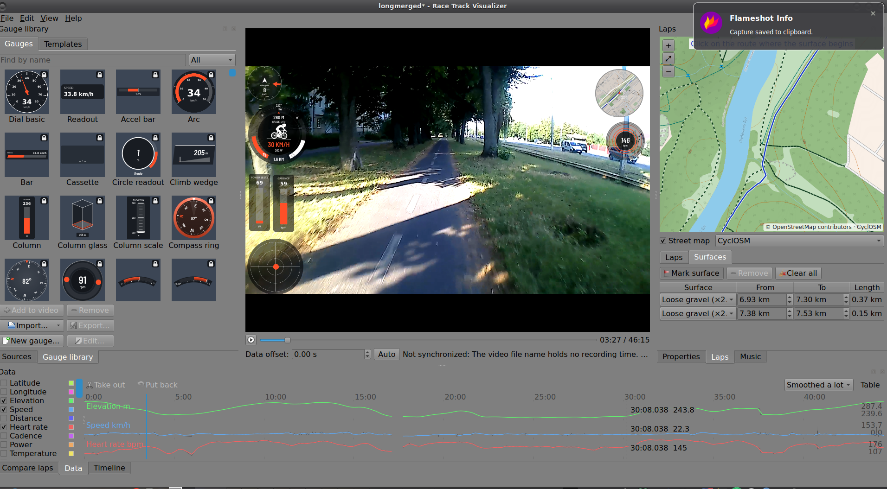
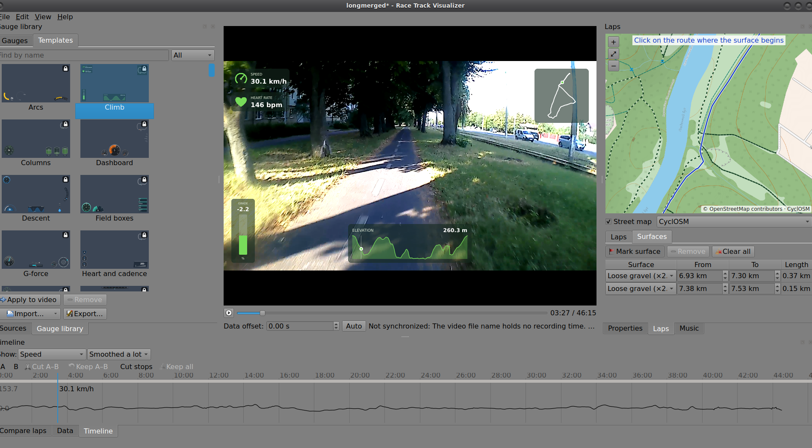
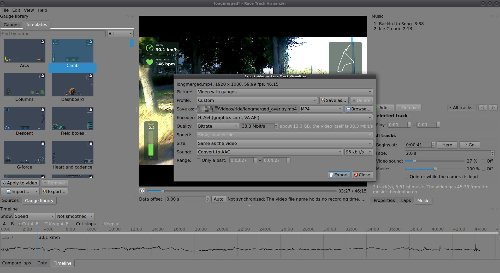

# Race Track Visualizer - User manual

Race Track Visualizer puts the data of a ride, a run or a track day on its video: speed, lap
times, G-force, the route on a map, heart rate, power and more, drawn as gauges over the footage
and exported as a new video.

- [1. Installing](#1-installing)
- [2. The window](#2-the-window)
- [3. A first video in five steps](#3-a-first-video-in-five-steps)
- [4. Video](#4-video)
- [5. Data](#5-data)
- [6. Synchronizing video and data](#6-synchronizing-video-and-data)
- [7. Gauges on the video](#7-gauges-on-the-video)
- [8. Templates](#8-templates)
- [9. Laps, sectors and surfaces](#9-laps-sectors-and-surfaces)
- [10. Timeline and cuts](#10-timeline-and-cuts)
- [11. Data viewer and corrections](#11-data-viewer-and-corrections)
- [12. Comparing laps](#12-comparing-laps)
- [13. Maps, terrain and weather](#13-maps-terrain-and-weather)
- [14. Music](#14-music)
- [15. Exporting](#15-exporting)
- [16. The gauge editor](#16-the-gauge-editor)
- [17. Projects and files](#17-projects-and-files)
- [18. Settings](#18-settings)
- [19. Command line](#19-command-line)
- [20. Updates](#20-updates)
- [21. When something goes wrong: logs and diagnostics](#21-when-something-goes-wrong-logs-and-diagnostics)
- [22. Keyboard shortcuts](#22-keyboard-shortcuts)

## 1. Installing

See [Installation in the README](../README.md#installation): the AppImage, the .deb, Fedora's
Copr, the Ubuntu PPA, the Windows installer or zip, and the macOS app.

The program reads, joins and exports videos with **its own video engine**, FFmpeg's libraries built
in (the AppImage, Windows, macOS and Fedora packages have it). It can use the **ffmpeg program**
instead (Settings > Export > Video engine), for reading videos and music, joining and exporting
alike: a newer ffmpeg you installed may read or encode what the built-in one cannot. Where the
chosen one fails to read a file, the other one tries. Without the engine (the .deb for Ubuntu
22.04) everything goes through the ffmpeg program. The Windows packages bring the ffmpeg program too; the Linux packages
pull it in; on macOS it comes from Homebrew (`brew install ffmpeg`) or MacPorts, and the program
finds it in `/opt/homebrew/bin`, `/usr/local/bin` or `/opt/local/bin` by itself. Its location can be set in
Settings > Export when it is somewhere else.

## 2. The window



- **The video** in the middle, with the gauges over it, the play button, the position slider and,
  under it, the **data offset** that keeps the data in step with the picture.
- **Panels** around it, each of which can be moved, stacked as tabs, floated or closed:
  - *Sources*: the video and the data in use, elevation, the weather and the wind.
  - *Gauge library*: gauges and templates to put on the video (tabs *Gauges* and *Templates*).
  - *Properties*: what the selected gauge shows, its colors, font, text size and opacity.
  - *Laps*: the route on a map, the start/finish and sector lines, the lap table and surfaces.
  - *Music*: tracks played under the video.
  - *Timeline*, *Data* and *Compare laps*: charts of the ride (sections 10-12).
  - *Diagnostics*: what the program does inside, for reports (section 21).
- **View** lists every panel, to bring back a closed one; **View > Reset layout** puts them all
  where they were at the start.

Files can be dropped on the window: a project opens, a video opens, data is read, gauges and
templates (or folders of them) go into the library.

## 3. A first video in five steps

1. **File > Open video** (Ctrl+O). A camera that splits long recordings into parts: open the
   first part and accept joining them.
2. **File > Open data** (Ctrl+D): the FIT, GPX, TCX or other file of the same ride. A GoPro
   video carries its own data: then nothing else is needed.
3. Check the **data offset** under the video: the status next to it says whether the video and
   the data were put in step by their clocks. If not, see section 6.
4. In the **Gauge library**, open *Templates*, pick one and press **Apply to video**, or drag
   single gauges from *Gauges* onto the picture. Move and size them with the mouse.
5. **File > Export video** (Ctrl+E), choose a profile, press **Export**.

Save the work with **File > Save project** (Ctrl+S) to come back to it later.

## 4. Video

- **Open video** takes MP4, MOV, MKV, AVI, M4V, MTS and WebM.
- **Join videos** (File menu) puts several videos into one file. Videos of one kind (the same
  camera and settings; a video exported here is of another kind than the camera's own) are
  copied without encoding, in seconds; camera parts (GX01xxxx,
  GX02xxxx...) are put in order. The built-in engine also copies an .mkv and an .mp4 of the same
  video together; the ffmpeg program cannot (its times would come out wrong) and encodes them
  instead. When they cannot be copied, the dialog says why and offers to
  encode them again into one shape and frame rate. Breaks between recordings are found from their
  times and kept, so the data stays in step after each break. GoPro data is kept in the joined
  file when every part has it.
- **Without a video** (File menu): no camera video needed. The gauges are drawn over a plain
  color, or over nothing (see-through, to lay over another video in an editor), at a size and
  frame rate you choose: 1920 x 1080, upright 1080 x 1920 for phones, square, 4K or 720p. The
  picture is as long as the data and plays on the data's own time, so there is nothing to
  synchronize. A big map of the route makes a video of the ride by itself; music, cuts and
  templates work as with a video. Opening a video later puts the background aside.
- The preview decodes on the graphics card where it can; Settings > Preview turns that off or
  picks the decoder.
- **Space** plays and pauses; the slider or the timeline moves through the video.

## 5. Data

**Open data** reads:

| Kind | Files |
|---|---|
| Bike computers, watches | FIT, GPX, TCX |
| GoPro | the camera's own MP4 (positions, speed, accelerometer, gyroscope) |
| GPS loggers | NMEA (`.nmea`, `.txt`, `.log`), VBO |
| Lap timers and loggers | CSV with a data profile (AiM, Racelogic, TrackAddict, or one of your own; XML data profiles import) |

**File > Add data from other files** adds channels of other recordings of the same ride - a
chest strap, a power meter - to the main data, lined up by their clocks or shifted by hand.

What the recording lacks is **worked out** from the rest and shown in italics in the channel
lists: distance, speed, heading, grade, climb and descent, vertical speed, G-forces, pace,
averages, gears (from the speed and the cadence with the bike set up in Settings > Bike) and an
**estimated power** (Settings > Power, with the weather and the surfaces when known). An estimate
never replaces a recorded power.

## 6. Synchronizing video and data

The program reads the recording time from the video (its file name or its own creation time)
and from the data, and puts them in step by itself; time zones that disagree by whole hours are
corrected. What was found is shown in the status bar and in the tooltip of **Data offset**.

When it is off:

- type an offset in seconds under the video, or press **Auto** to work it out again;
- or, on the **Timeline**, hold **Ctrl** and drag the data against the video until a moment you
  recognize (a start, a stop, a corner) lines up.

The data of a GoPro video is already on the video's clock: there is nothing to synchronize.

A **time-lapse** video (a camera's TimeLapse or a phone's hyperlapse) shows many seconds of the
ride in each of its own. Set **Time-lapse** under the video to the camera's speed-up (x10, x30;
x1 for an ordinary video): the gauges then run that much faster with the picture. Set it before
pressing **Auto**, so the clocks are matched over the whole time-lapse.

## 7. Gauges on the video

- **Add**: drag a gauge from the library onto the picture, or select it and press **Add to
  video**. It starts on the measurement it was made for.
- **Move** by dragging; **size** with the handles. **Delete** removes the selected gauge,
  **Esc** deselects it.
- **Right-click** a gauge for its menu:
  - *Show*: the measurement it shows;
  - *Street map*, *Map*, *Close-up* (300 m to 5 km around the rider, *Custom...* for any
    distance, or *Dynamic, by speed...*: close when slow, wider when fast, in proportion between
    two speeds you set, following the speed of the last few seconds), *The way ahead up*,
    *3D flyover*: for gauges with a route. The flyover shows the land in 3D around the rider,
    the camera behind and above them looking ahead: the terrain's heights (hills a bit higher than
    they are, so that they show), the gauge's map laid over them, shaded by a low sun and fading
    into the sky far away; the route ridden so far in the gauge's color, the rest faint. The
    close-up sets how far the land reaches (two and a half times it each way; a kilometer
    without one); *3D flyover camera...* sets the camera's tilt (60° from looking straight down:
    more looks further ahead), its height above the rider (100 m) and how many times higher the
    hills are drawn (x1.5), or puts back the gauge's own (the gauge editor has them too). Made big
    over a background (*Without a video*) it is a video of the ride by itself. It is drawn
    without the graphics card, the same in the preview and the export: a full HD flyover takes
    a few hundredths of a second a frame;
  - *Units*: as in the settings, metric or imperial, for this gauge alone;
  - *Keep the gauge's shape*: off, the handles on the right and bottom edges change only the
    width or the height - an elevation profile or a graph can then run across the picture;
  - *Remove*.
- **Properties** panel: what the selected gauge shows, the **colors and font** of every gauge
  (or, with *Own colors and font*, of the selected one alone), **text size** and **opacity**.
- **Edit > Undo** (Ctrl+Z) and **Redo** take back any change on the video.
- When a video of another shape is opened (a vertical one after 16:9), the gauges are placed
  again from their nearest edges, as one step that can be undone.

## 8. Templates

A template is a set of gauges with their places. In the library's *Templates* tab, **Apply to
video** (or dragging the template onto the picture) replaces the gauges on the video with it,
laid out for the video's shape.



- **File > Save the gauges as a template** keeps what is on the video as a template of your own,
  with a name and a category.
- The library finds gauges and templates by name and by group (where they come from, what they
  show, a template's category).
- **Import** brings in `.rtvgauge` / `.rtvtemplate` files, `.veg` / `.vet` files, XML gauges
  and templates, or a folder of them. **Export** passes a gauge or a template (with its gauges)
  on as one file.
- Gauges and templates that come with the program carry a padlock: they can be used and copied,
  not changed.

## 9. Laps, sectors and surfaces

The **Laps** panel shows the route on a street map (wheel or + and − to zoom, drag to move).

- **Place start/finish**, then click on the route where laps begin: the line is put across the
  route there and laps are timed between crossings. Without a line the laps the device recorded
  are used.
- **Add sector**, then click where a sector ends: each line splits the lap once more. The lap
  table then shows sector times, the fastest of each in purple.
- The **lap table**: the best lap in bold; double-click a lap to go to its start; select several
  to compare them (section 12).
- **Surfaces** tab, **Mark surface**: click where a stretch begins and where it ends, and choose
  smooth, typical or rough asphalt, gravel or dirt. Used by the power estimate.

Lap and sector times are channels like any other: lap time, previous lap, best lap, delta to the
best, sector time and so on, shown by the lap gauges, the *Lap table* and the *Sector bar*.

## 10. Timeline and cuts

The **Timeline** shows the video and the data where the offset puts them, a chosen measurement
(**Show:**), laps as bands with sector ticks, pauses hatched and the playhead.

- Click or drag to go there; wheel to zoom about the mouse, Shift+wheel to pan.
- **Ctrl+drag** slides the data against the video (sets the offset).
- **Cuts** leave parts of the video out of the export: mark the start with **[** and the end with
  **]** (or Shift+drag), then **Cut A-B** (Delete). **Cut stops** finds every stop of 10 s or more
  and leaves it out, keeping 2 s at each end. **Keep A-B** and **Keep all** put parts back. The
  gauges keep the true values of what is kept, so lap times stay right.

## 11. Data viewer and corrections

The **Data** panel charts the ticked channels on the data's own time. Hover to read values,
click to go there.

- A GPS jump or a spike: pick it with **Shift+drag** on the chart, or select samples in the
  **Table**, and press **Take out**. Latitude and longitude go together; speed, distance, grade and
  laps follow. **Put back** returns them. Corrections are kept in the project and can be undone.
- One **smoothing** setting (none, 2, 5 or 15 s) applies to the Data, Timeline and Compare laps
  charts; it changes the drawing only, not the data.

## 12. Comparing laps

Select laps in the lap table: **Compare laps** draws them against the distance into the lap,
with how far each is behind the fastest of them at the same point below. Hover to read all of
them at one place.

## 13. Maps, terrain and weather

- **Street maps** under route gauges and in the Laps panel, chosen in Settings > Maps; a gauge
  can have a map of its own from its menu.
  - Free: OpenStreetMap (standard, Humanitarian, France), CyclOSM, OpenTopoMap, ÖPNVKarte (public
    transport), Esri satellite, topographic and streets, a shaded relief, IGN France (map and aerial
    photos) and USGS (USA, topographic and imagery).
  - With a key of your own (most have a free allowance): Thunderforest (OpenCycleMap, Outdoors,
    Landscape, Transport), Stadia Maps (Alidade Smooth and Dark, Outdoors, Stamen Terrain, Toner,
    Watercolor), MapTiler (Streets, Outdoor, Topo, Winter, Satellite) and Mapbox (Satellite
    Streets, Outdoors, Streets). Enter the key under Keys in Settings > Maps ("Get a key" opens the
    service's page); the service's maps are offered from then on. A map whose key is removed is
    drawn as the settings' map.
  - Or your own tile server: any address with `{z}`, `{x}` and `{y}`.
  - IGN and USGS show their own country close up (IGN France, USGS the USA); elsewhere they
    only have the coarse levels, and the map is drawn from those, enlarged and blurry. Any map
    does the same where a tile is missing or still coming. Tiles are kept on disk, so a
  ride previewed once exports without a connection. The map's credit is drawn in its corner and
  can be switched off. Settings > Maps also shows how much the stored tiles take and deletes them.
- **Elevation from the terrain**: in the Sources panel, the height of the ground under the route
  from a terrain model - for recordings without an elevation (the default), in place of the
  recorded one, or never. A road on a bridge or in a tunnel gets the ground's height.
- **Weather**: for the power estimate, the wind, temperature and pressure of the day from a
  weather history service (Settings > Weather), or a wind entered by hand in the Sources panel.

An export started while tiles, heights or the weather are still being fetched asks first.

## 14. Music

The **Music** panel plays files one after another from a chosen moment of the video, each
trimmed, with fades. The video's own sound and the music have volumes of their own (up to 200 %,
held under full scale), and the music can be **quieter while the camera is loud**. Heard in the
preview and mixed into the export.

## 15. Exporting



**File > Export video** (Ctrl+E):

- **Picture**: the video with the gauges, or the gauges alone on a transparent background
  (ProRes 4444 or VP9 WebM) to lay over the video in another editor.
- **Profile**: YouTube upload, small file (HEVC or AV1 with Opus in MKV), like the video, or one
  you saved (**Save as...**).
- **Engine**: which one runs the export - built in, or the ffmpeg program (chosen in
  Settings > Export; the other one is used when the chosen one has no encoder that works).
- **Encoder**: only those that work on this computer are listed - graphics card (VA-API, NVIDIA,
  AMD, Quick Sync, VideoToolbox) or processor.
- **Quality**: a bitrate (with the expected file size) or a constant quality; **Speed**; **Size**.
- **Sound**: copied, converted (AAC, Opus, Vorbis) or left out; mixed with the music when there
  is any.
- **Range**: only a part of the video.
- **Faster**: the output plays this many times faster (x2, x4...), so a long, slow recording such as
  a run becomes a short video; the length it will have is shown next to it. The gauges keep showing
  the real values of each moment kept. The camera's sound is left out then; music plays as usual.

Stopping an export keeps a playable video of what was done so far; a failed export leaves no
file.

## 16. The gauge editor

In the library, **New gauge...** starts an empty gauge and **Edit...** opens the selected one
(gauges that come with the program open as a copy).

- The **parts** are listed on the left; the **picture** in the middle shows the gauge with a
  sample ride, where parts are picked, moved and sized with the mouse (arrow keys move by a
  pixel); the picked part's **properties** are on the right.
- Parts: texts, pictures (SVG and bitmaps), rectangles, ellipses, arcs, pies, lines and polygons
  (straight or smooth), needles, filling bars and arcs, round and sliding scales, graphs, route
  and lap maps (with a street map), lap tables, sector bars, gears, and groups.
- **Movements** make a part follow a value: turn, fill, slide, a ball moved by two values
  (g-forces, with a fading trail), a picture strip. A part can have several, applied in order.
- Fills can fade to another color along a line; texts can sit in a box and wrap.
- Pick several parts with Ctrl or Shift to move them together and line them up.
- Undo and redo work in the editor too.

## 17. Projects and files

| File | What it is |
|---|---|
| `.rtvproj` | a project: the video, the data, the offset, the gauges, cuts, laps, music (paths only) |
| `.rtvgauge` | one gauge, to pass on |
| `.rtvtemplate` | a template with its gauges, to pass on |

The installers and Linux packages open these by a double click. Closing the window with changes
not saved asks first.

Where the program keeps things (`trackrideviz` is the program's name):

| | Linux | Windows | macOS |
|---|---|---|---|
| Settings | `~/.config/trackrideviz/trackrideviz.conf` | registry `HKEY_CURRENT_USER\Software\trackrideviz\trackrideviz` | `~/Library/Preferences/com.trackrideviz.trackrideviz.plist` |
| Your gauges, templates, data profiles | `~/.local/share/trackrideviz/trackrideviz/` | `%APPDATA%\trackrideviz\trackrideviz\` | `~/Library/Application Support/trackrideviz/trackrideviz/` |
| Map tiles, terrain, weather (can be deleted) | `~/.cache/trackrideviz/trackrideviz/` | `%LOCALAPPDATA%\trackrideviz\trackrideviz\cache\` | `~/Library/Caches/trackrideviz/trackrideviz/` |

## 18. Settings

**File > Settings**:

- **Appearance**: style, light or dark, language, window layout.
- **Preview**: decoding on the graphics card, the decoder.
- **Units**: speed, length, temperature.
- **Export**: the video engine (built in or the ffmpeg program), where the ffmpeg program is, the
  folder for exported videos.
- **Maps**: the map, the keys of map services, your own server, downloads on or off, the credit,
  stored tiles.
- **Bike**: chainrings, sprockets and wheel, for gears worked out from speed and cadence.
- **Power**: the estimate on or off; rider and bike weight, height, tires, riding position.
- **Surfaces**: how each surface adds to the rolling resistance.
- **Weather**: the weather history service (and its key), how often along the route to ask.
- Checking for updates on or off (section 20).

## 19. Command line

The program exports without its window too:

```bash
trackrideviz --render ride.rtvproj                       # as the project was saved
trackrideviz --render ride.rtvproj -o ride.mp4 --profile youtube --hardware
trackrideviz --render --video GX010042.MP4 --data ride.fit --template "Track day"
trackrideviz --render ride.rtvproj --gauges-only -o gauges.mov
trackrideviz --render --data ride.fit --background 1920x1080@30,#202830 --template Ride
trackrideviz --list-encoders                             # what this computer can encode with
trackrideviz --list-profiles
trackrideviz --list-templates
trackrideviz --help                                      # every option
```

- A project is exported as it was saved. Without one, the video and the data are put in step by
  their clocks, or by `--offset`. `--timelapse 10` is for a time-lapse video (ten seconds of the data
  in each second of it); `--faster 4` makes the output play four times faster.
- `--background` in place of a video: the gauges over a color, as long as the data. A size, then
  `@` a frame rate (30 if not given) and `,` a color (`#rrggbb`, black if not given, or
  `transparent` for the gauges alone, written as with `--gauges-only`). The file is named after
  the data.
- `--engine builtin` or `--engine ffmpeg` picks the engine (otherwise as in the settings).
- The profile and the kind of encoder are those the export dialog used last unless `--profile`,
  `--encoder`, `--hardware` or `--software` say otherwise; `--bitrate`, `--quality`, `--speed`,
  `--height`, `--audio`, `--audio-bitrate`, `--from` and `--to` set each choice by hand.
- `-y` overwrites an existing file; `-q` prints no progress, only the outcome; `--verbose` adds
  Qt's own messages.
- Ctrl+C stops and keeps a playable file.
- Exit codes: 0 done, 1 failed, 2 wrong arguments, 130 stopped.
- Many videos in a row: a shell loop, for example
  `for p in *.rtvproj; do trackrideviz --render "$p" -y || break; done`.

On Windows, run `trackrideviz.exe` from a Command Prompt or PowerShell window: it writes to that
window.

## 20. Updates

Release builds look once a day, quietly, for a newer release on GitHub (switch in Settings). A
newer one shows as a link in the status bar and under **Help**, with its notes; **Skip this
version** stops it showing. **Help > Check for updates** looks at once.

- **AppImage**: **Update now** downloads the new one, checks it and puts it in place of the old;
  restart to use it. Tools that manage AppImages (AppImageUpdate, appimaged, Gear Lever,
  AppImageLauncher) can update it too.
- **Windows installer**: **Update now** downloads the new installer, checks it and runs it once
  the program is closed.
- **Packages** (.deb from the PPA, Copr) update with the system; the **zip** and **macOS** only
  link to the release page.

## 21. When something goes wrong: logs and diagnostics

The program keeps no log file of its own: a log written on every run grows without end. Instead
it keeps what it says in memory and shows it where you can copy it, and it writes the same to
the terminal it was started from.

### The Diagnostics panel

**View > Diagnostics** shows:

- **start-up details**: the Qt version and the display system, whether it runs from an AppImage,
  the settings that decide where Qt and the video player take their plugins from, the sound
  devices found, and the font, screen scale and icon theme;
- **the players' state**: what the video and sound players are doing;
- **the log**: the last 5000 messages of Qt, the video player and the program, each with its time.

**Copy all** puts all three on the clipboard, to paste into a bug report. **Clear** empties the
log, so that what happens next stands out: clear, repeat what went wrong, copy.

### Messages in a terminal

To see everything as it happens, or what happens before the window opens, start the program from
a terminal:

```bash
# Linux, from a package
trackrideviz 2>&1 | tee trackrideviz.log
# Linux, the AppImage
./Race_Track_Visualizer-x86_64.AppImage 2>&1 | tee trackrideviz.log
# macOS
/Applications/trackrideviz.app/Contents/MacOS/trackrideviz 2>&1 | tee trackrideviz.log
```

On Windows the program has no console window; to see its messages, set Qt's debug output to a
file in a Command Prompt before starting it:

```bat
set QT_FORCE_STDERR_LOGGING=1
trackrideviz.exe 2> trackrideviz.log
```

and stop the program before opening the file. (A Command Prompt in a protected folder such as
Program Files cannot write there: `cd %USERPROFILE%` first and give the program's full path.)

More from a part of Qt, with `QT_LOGGING_RULES` set before starting:

| Problem | Variable |
|---|---|
| Empty or black window, graphics | `QT_LOGGING_RULES=qt.qpa.gl=true` |
| Video does not play, no sound | `QT_LOGGING_RULES=qt.multimedia*=true` (Linux AppImage and Qt 6.2: also `GST_DEBUG=3`) |
| Maps do not load (network, certificates) | `QT_LOGGING_RULES=qt.network*=true` |

(`export VAR=value` in a Linux or macOS terminal, `set VAR=value` in a Windows Command Prompt.)

### Reading a log

- Lines with `[warning]`, `[critical]` or `[fatal]` are where to start; `[debug]` and `[info]`
  are background.
- **Export fails**: the message ends with what ffmpeg or the built-in engine reported; the command
  line prints the same, and `--verbose` adds Qt's and the engine's own messages (`rtv.libav:` lines).
  Trying the other engine (Settings > Export, or `--engine`) tells whether it is the engine's doing. "Unknown encoder" or "Error while
  opening encoder" points at the encoder: try `--software` or another encoder in the dialog.
- **No encoders listed / export does nothing**: ffmpeg was not found or does not run. Check
  `ffmpeg -version` in a terminal (Windows: the `ffmpeg` folder next to the program), or set its
  location in Settings > Export.
- **Empty window on Windows** (virtual machines, remote desktops): start it with
  `QT_LOGGING_RULES=qt.qpa.gl=true` as above; the log names the OpenGL driver. "Microsoft Basic
  Render Driver" or "GDI Generic" means no real graphics driver, and Qt should then draw in
  software with the `opengl32sw.dll` next to the program - a log that says it could not load it
  means that file is missing.
- **Maps stay empty**: look for SSL or network errors; check Settings > Maps (downloads on, a key
  where the map needs one).

Attach the copied diagnostics (or the log file) to an
[issue](https://github.com/coozoo/trackrideviz/issues), with what you did and what you expected.

## 22. Keyboard shortcuts

| Key | Does |
|---|---|
| Space | play / pause |
| Ctrl+O | open video |
| Ctrl+D | open data |
| Ctrl+Shift+O | open project |
| Ctrl+S / Ctrl+Shift+S | save project / save as |
| Ctrl+E | export video |
| Ctrl+Z / Ctrl+Shift+Z (Ctrl+Y) | undo / redo |
| Delete, Backspace | remove the selected gauge |
| Esc | deselect the gauge |
| [ and ] | mark the start (A) and end (B) of a part on the timeline |
| Delete (timeline) | cut the part between A and B |
| Arrow keys (gauge editor) | move the picked part by a pixel |
| Ctrl+Q | quit (Linux, macOS; Alt+F4 on Windows) |
